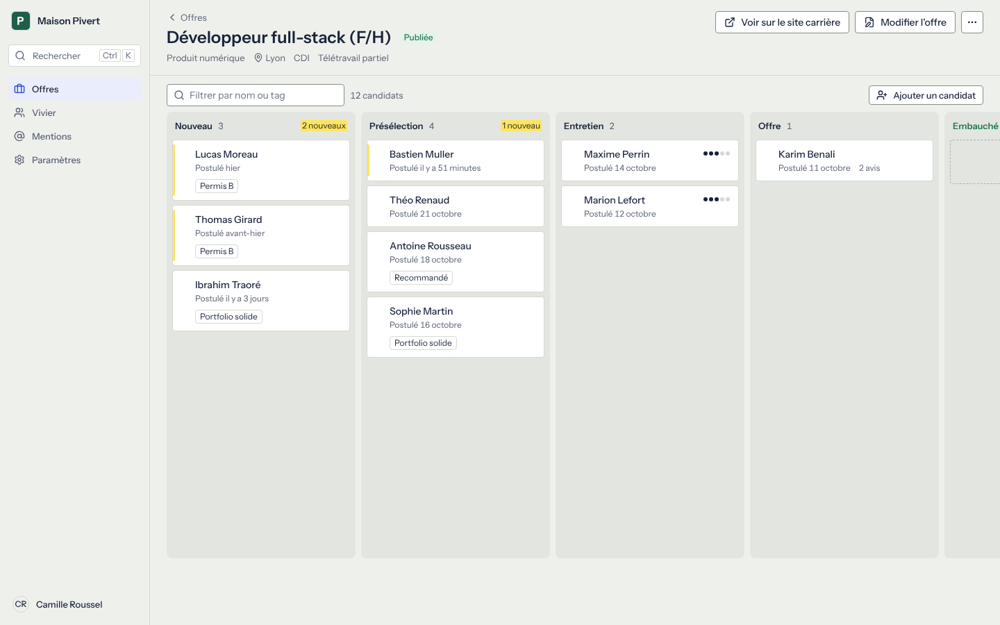
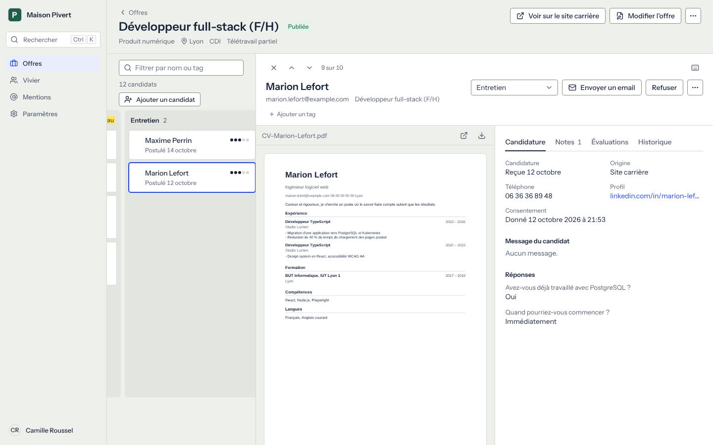
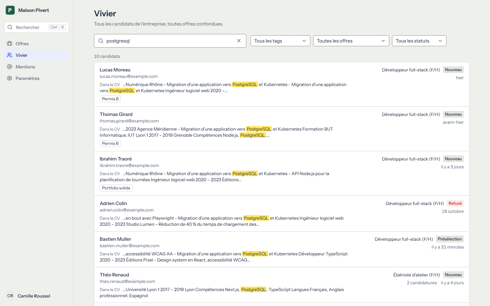
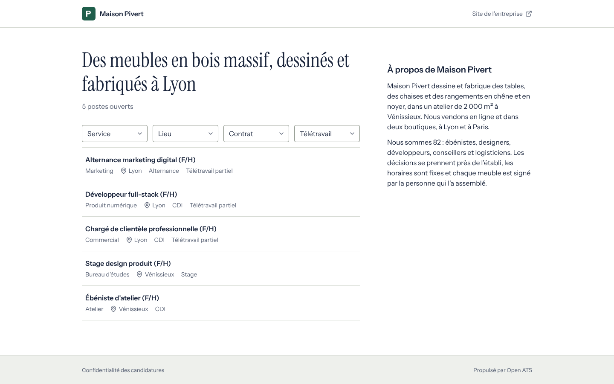
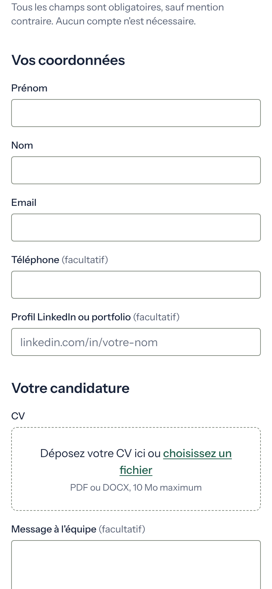
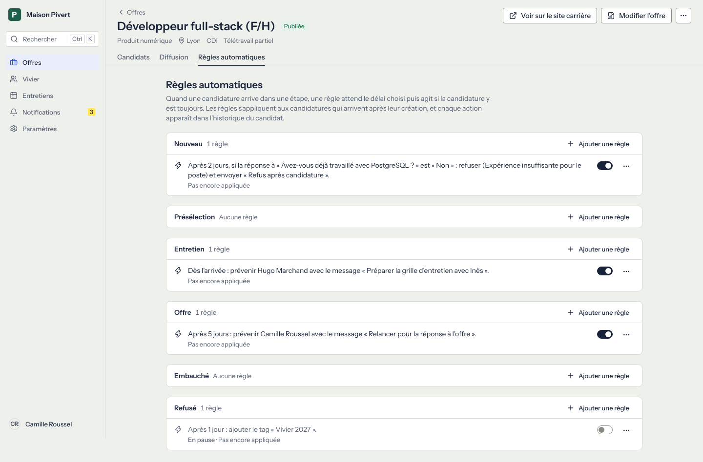

# Open ATS

An open source applicant tracking system and career site for small and medium companies
(10 to 250 people, 1 to 5 recruiters). Self-hosted, one `docker compose up` away. French
interface by default, English available.



| Candidate next to the pipeline                                                                | Talent pool search                                                                                    |
| --------------------------------------------------------------------------------------------- | ----------------------------------------------------------------------------------------------------- |
|  |  |



| Career site on a phone                                                                              | Job page                                                                                          | Application form                                                  |
| --------------------------------------------------------------------------------------------------- | ------------------------------------------------------------------------------------------------- | ----------------------------------------------------------------- |
|  |  |  |

The screenshots show the demo data: Maison Pivert, a fictional furniture maker.

## Try it

```sh
git clone https://github.com/pauldelacv/open-ats.git
cd open-ats
docker compose up -d
```

Open <http://localhost:3000> once the containers are up: the first start builds the image,
which takes a few minutes, then creates the demo. Sign in with `demo@open-ats.example` /
`demo-open-ats`, or follow **Créer votre espace recrutement** on the sign-in page to set up
your own company next to the demo.

For a real deployment (Docker on a server, Coolify, reverse proxy, backups), read
[docs/DEPLOY.md](docs/DEPLOY.md).

## What it does

- **Career site** per company: logo, colour, photo and presentation, a filterable list of
  open positions, job pages with `JobPosting` structured data, a sitemap, and an application
  form that takes under two minutes, without an account (CV in PDF or DOCX up to 10 MB,
  custom questions, timestamped consent).
- **Jobs**: rich description, department, location, remote policy, contract type
  (CDI, CDD, freelance, alternance, stage), optional salary range, custom questions,
  draft / published / archived.
- **Pipeline**: one board per job with editable stages, drag and drop or keyboard moves,
  undo from the notification, bulk move, reject, tag and email.
- **Candidate panel** next to the board: CV preview beside the application, notes with
  @mentions, tags, evaluations on 1 to 5 hidden until you give your own, history, rejection
  with a reason and an email. Shortcuts J / K, 1–5, E, R and `?`.
- **Emails**: templates with `{{prénom}}`, `{{offre}}`, `{{entreprise}}` and their English
  names, sent over SMTP. Without SMTP every email is kept in a journal instead.
- **Distribution**: one tracked link per channel (LinkedIn, Indeed, Welcome to the Jungle,
  referral… editable), the ad text ready to paste, an XML feed for job aggregators, and the
  number of applications from each channel.
- **Candidates' replies**: with a shared mailbox read over IMAP, replies land in the
  candidate's « Échanges » tab next to the emails sent, with attachments, an unread marker on
  the card and a notification to the sender.
- **Interviews**: free times computed from each interviewer's calendar (secret ICS address,
  no OAuth), a page where the candidate picks a slot, invitations that any calendar accepts,
  video rooms on Jitsi, and an « Entretiens » page for the week.
- **Automatic rules** per stage: when an application arrives, after a delay and if an answer
  matches, send an email, reject with a reason, tell the team, add a tag, move it or offer
  interview slots. Written as sentences, paused with a switch, shown in the history.
- **Talent pool**: full-text search on names, emails, notes and CV text, one profile per
  email address across applications.
- **Team**: admins, recruiters, and members who only see the jobs they are assigned to.
  Sign-in by password or by a link sent by email; invitations.
- **GDPR**: retention period per company (24 months by default) with automatic
  anonymisation, candidate export as a ZIP, permanent deletion, a privacy page on the
  career site.
- **⌘K / Ctrl K** palette to jump to a candidate or a job, or create a job.

Not built yet: analytics, a public API, two-way calendar sync, SMS. There is no AI in the
product.



## Develop

Requirements: Node.js 22.12 or later, and PostgreSQL 16 (any local instance, or the
container below).

```sh
docker run -d --name open-ats-pg -p 5432:5432 \
  -e POSTGRES_USER=openats -e POSTGRES_PASSWORD=openats -e POSTGRES_DB=openats \
  postgres:16-alpine
npm install
SEED_DEMO=true npm run dev
```

The server applies migrations at start. `.env.example` lists every variable; copy it to
`.env` to change them.

The test suites use their own databases, emptied at each run:

```sh
docker exec open-ats-pg createdb -U openats openats_test
docker exec open-ats-pg createdb -U openats openats_e2e
```

| Command                                                     | What it does                                                                                                                                                                                                                         |
| ----------------------------------------------------------- | ------------------------------------------------------------------------------------------------------------------------------------------------------------------------------------------------------------------------------------ |
| `npm run lint`, `npm run typecheck`, `npm run format:check` | Static checks, as in CI.                                                                                                                                                                                                             |
| `npm test`                                                  | Unit and database tests (Vitest), including the organisation isolation tests. Database: `TEST_DATABASE_URL`, `openats_test` by default.                                                                                              |
| `npm run test:e2e`                                          | Full flow in a browser (Playwright): create a job, publish it, apply, find the candidate in the pipeline, move them, reject them with an email. Database: `E2E_DATABASE_URL`, `openats_e2e` by default; its name must contain `e2e`. |
| `npm run db:generate`                                       | New SQL migration after a change to `src/lib/db/schema.ts`.                                                                                                                                                                          |

## Documentation

- [docs/DEPLOY.md](docs/DEPLOY.md): deployment, configuration, backups.
- [docs/DESIGN.md](docs/DESIGN.md): the « Dossier » design system: tokens, components,
  writing rules. Every component is shown in all its states at `/design`.
- [docs/DECISIONS.md](docs/DECISIONS.md): technical and design decisions, with the reasons.
- [docs/PLAN.md](docs/PLAN.md): the v1 build plan.
- [docs/PLAN-v2.md](docs/PLAN-v2.md): the v2 plan (distribution, replies, interviews, rules).

## Stack

Next.js 16 (App Router), React 19, TypeScript, PostgreSQL 16 with Drizzle ORM, Better Auth,
Tailwind CSS 4, Radix UI primitives, dnd-kit, TipTap, Zod, next-intl, pdf.js, Vitest and
Playwright.

## License

[AGPL-3.0](LICENSE). You can use, modify and host Open ATS, including for a commercial
service; if you offer a modified version to users over a network, you must publish your
changes under the same licence.
